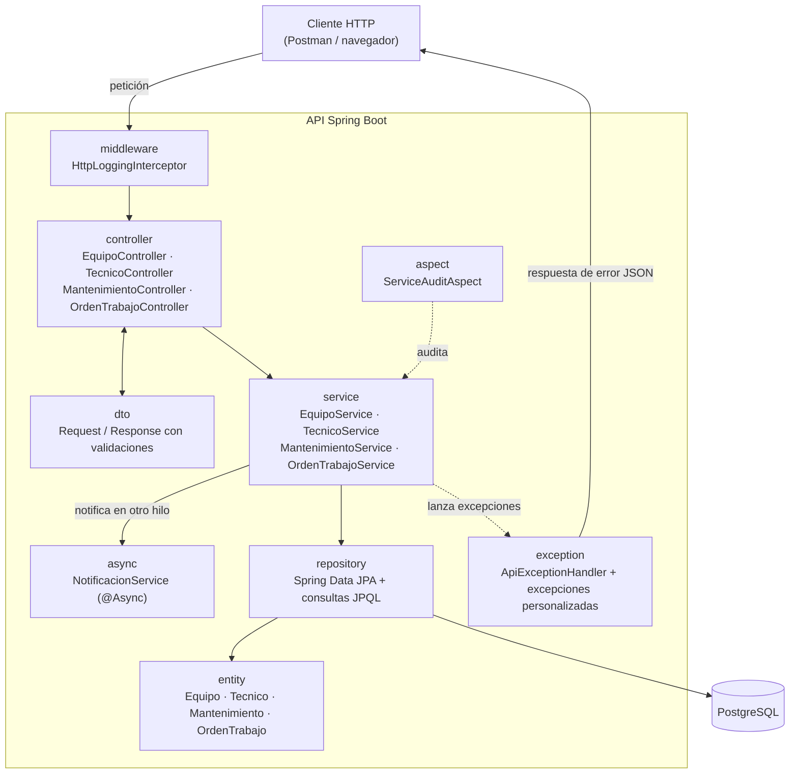

# Arquitectura en capas

- El **controller** solo recibe la petición y devuelve la respuesta; la lógica de negocio está en el **service**.
- El **interceptor** actúa antes y después de cada petición a `/api/**`.
- El **aspecto** envuelve todos los métodos de la capa de servicios.
- El **manejador global** convierte las excepciones en respuestas HTTP con el mismo formato.
