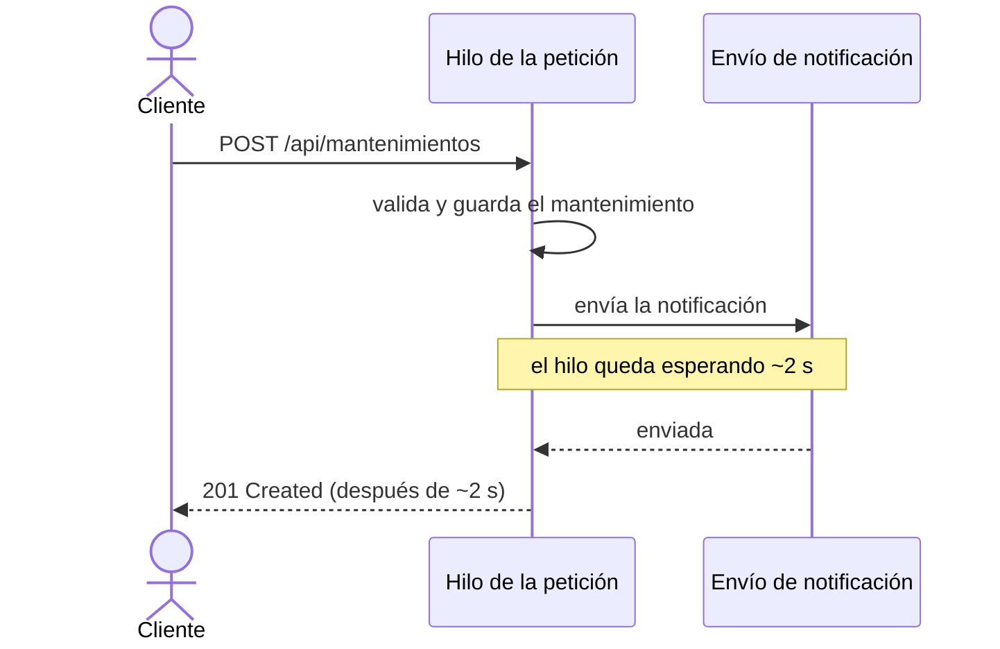
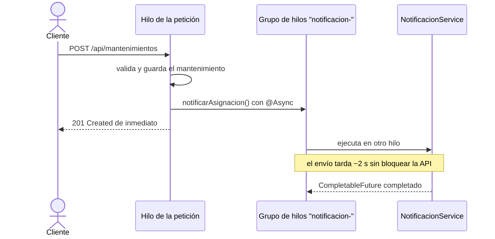

# Bloqueante vs. asíncrono: notificación al técnico

Al programar un mantenimiento se notifica al técnico asignado. El envío tarda unos 2 segundos (simulado con `Thread.sleep`).

## Si fuera bloqueante

## Como está implementado (asíncrono con @Async)

El grupo de hilos `notificacionesExecutor` (en `AsyncConfig`) tiene 2 hilos base, máximo 4 y una cola de 20 tareas, para no consumir recursos sin control.
