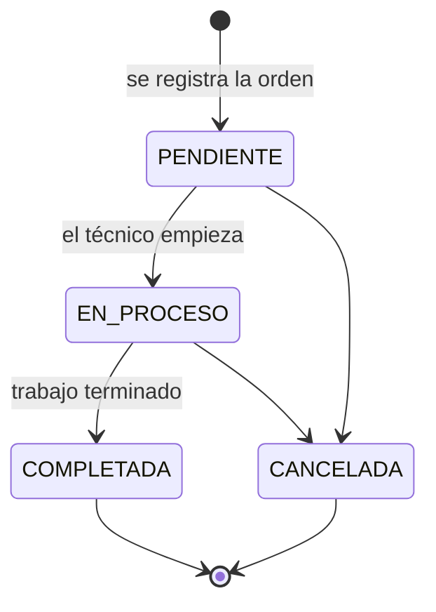

# Estados de la orden de trabajo

- `OrdenTrabajoService.cambiarEstado` valida cada cambio.
- Cualquier otra transición, por ejemplo `PENDIENTE → COMPLETADA` o reabrir una orden `COMPLETADA`, lanza `InvalidStateTransitionException` y la API responde **409 Conflict**.
- Una orden completada o cancelada tampoco se puede modificar: responde **422**.
