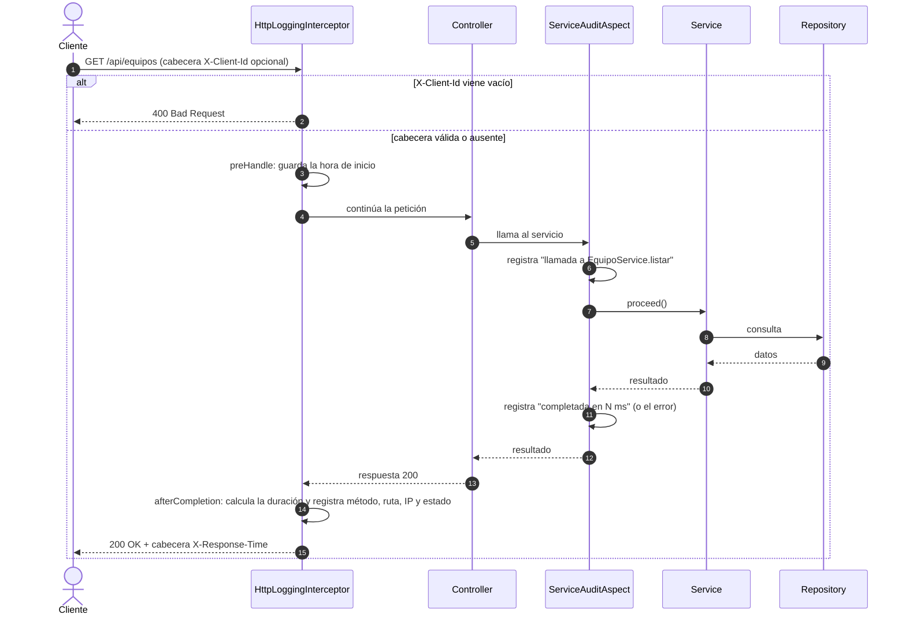

# Interceptor HTTP y aspecto de auditoría

- **Interceptor (middleware):** actúa a nivel HTTP, antes y después del controller, en todas las rutas `/api/**`.
- **Aspecto (AOP):** actúa a nivel de métodos, con un `@Around` sobre el paquete `service`. Mide y audita sin repetir código en cada servicio.
