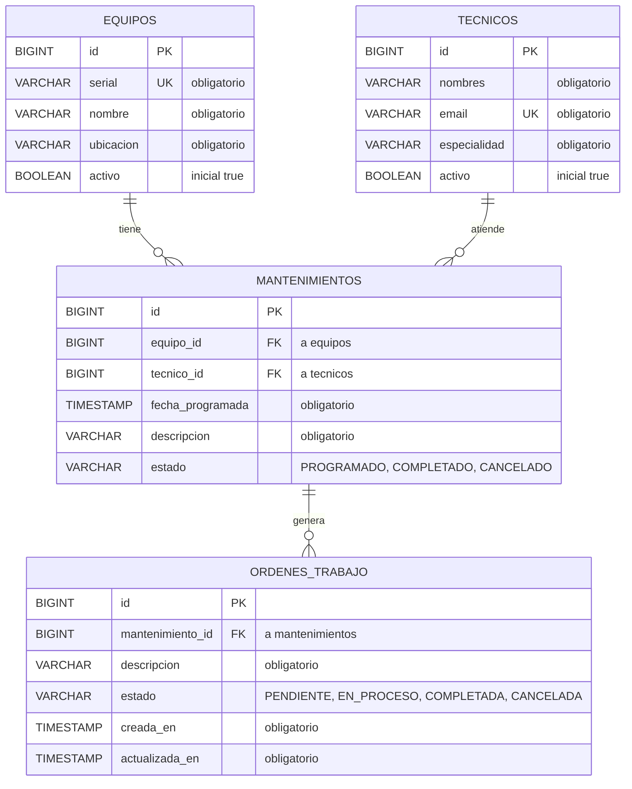

# Modelo entidad-relación

| Relación | Tipo | Clave foránea |
|---|---|---|
| Un equipo tiene muchos mantenimientos | 1 : N | `mantenimientos.equipo_id` |
| Un técnico atiende muchos mantenimientos | 1 : N | `mantenimientos.tecnico_id` |
| Un mantenimiento genera muchas órdenes de trabajo | 1 : N | `ordenes_trabajo.mantenimiento_id` |

Restricciones de integridad: claves primarias autogeneradas, `serial` y `email` únicos, y columnas obligatorias `NOT NULL`.
